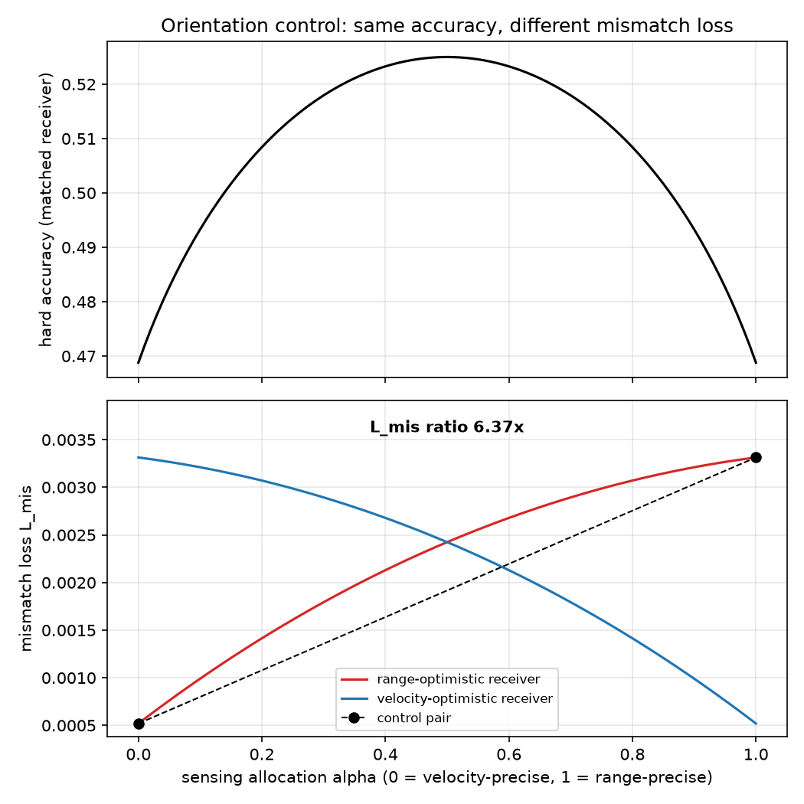
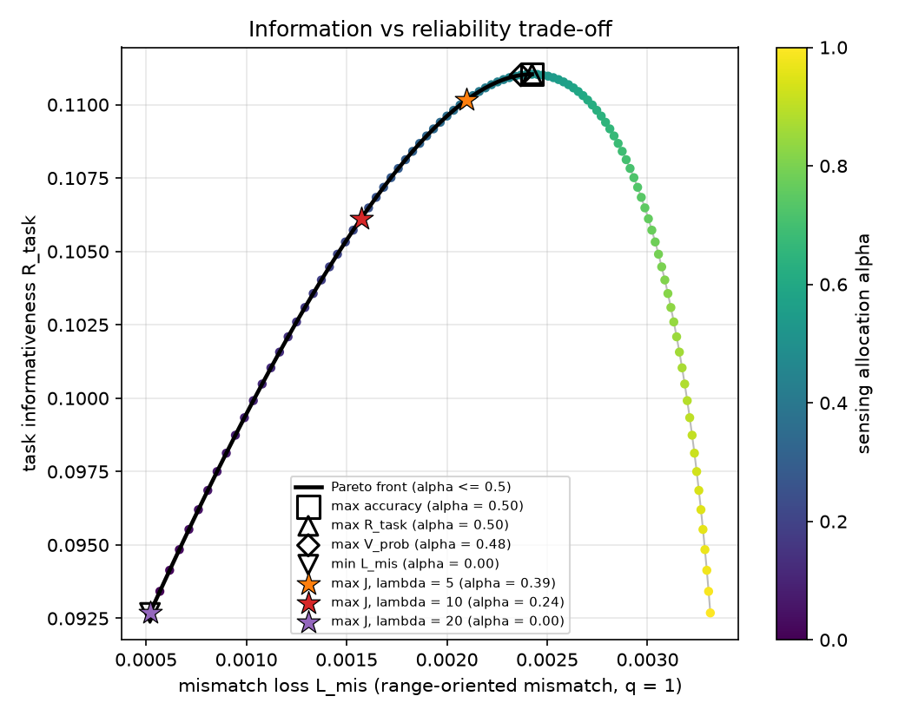

# Reliability-Aware Sensing Design for Semantic Communication under Probabilistic Channel Mismatch

This repository contains the code and results of my Master's research project. The project studies a sensing and semantic communication system in which the receiver does not only make a hard decision, but reports a full probability distribution over the possible states. The main question is how the sensing configuration should be chosen when the receiver uses a wrong model of the semantic channel, so that the reported probabilities stay useful and reliable.

All results, figures and tables in this repository can be reproduced with one command.

## Contents

1. [Motivation](#motivation)
2. [System model](#system-model)
3. [Research extensions and main results](#research-extensions-and-main-results)
4. [Repository structure](#repository-structure)
5. [Installation](#installation)
6. [How to run](#how-to-run)
7. [Figures and tables](#figures-and-tables)
8. [Testing and reproducibility](#testing-and-reproducibility)

## Motivation

In integrated sensing and semantic communication, a sensor observes a physical state, a semantic extractor turns the observation into a short token, and the token is sent over a channel to a receiver. In this project the receiver is a Bayesian receiver: it outputs a posterior probability for every state. These probabilities can later be used for sensor fusion, risk assessment or control, so they must be correct and not only the most likely state.

A problem appears when the channel at deployment is different from the channel model that the receiver uses. The receiver can still choose the right state, but with a wrong level of confidence. The amount of damage does not only depend on how large the mismatch is. It also depends on which semantic directions the sensing configuration resolves well. Two sensing designs with almost the same accuracy can therefore have very different reliability. This project investigates this interaction and uses it for sensing design.

## System model

The complete chain is

```
X  ->  Y_u  ->  Z  ->  M
```

| Symbol | Meaning |
|---|---|
| `X` | unknown state (four states from two binary factors: range and radial velocity) |
| `u`, `alpha` | sensing configuration; `alpha` moves sensing precision between range (`alpha = 1`) and velocity (`alpha = 0`) |
| `Y_u` | two-dimensional Gaussian measurement |
| `Z` | semantic token, produced by a two-bit sign extractor |
| `S_u` | state-to-token matrix, the finite experiment created by sensing and extraction |
| `W` | actual semantic channel at deployment (independent bit flips) |
| `W_hat` | channel model used by the receiver |
| `M` | symbol observed by the receiver |

The receiver computes the posterior with `W_hat`, while the data are generated with `W`. The main reliability metric is the mismatch-induced Brier loss `L_mis`, which is the extra expected Brier loss caused only by using the wrong channel model. The useful information of a design is measured by `R_task`, the reduction of Brier risk compared to a receiver that always reports the prior.

**Baseline result.** The designs `alpha = 0` and `alpha = 1` have exactly the same hard accuracy (0.4688), but with a receiver that is too optimistic about the range bit, their mismatch loss differs by a factor of **6.37**.



## Research extensions and main results

All extensions use the same baseline model. Unless stated otherwise, the setting is a uniform prior, bit-flip probability 0.10 on both bits, and a receiver that assumes 0.02 for the range bit.

### Extension 1: Task informativeness and mismatch vulnerability

Minimising `L_mis` alone is not a good objective, because a sensor that gives no information is also not vulnerable. I therefore compared five design rules on the same model: maximum accuracy, maximum `R_task`, minimum `L_mis`, maximum `V_prob = R_task - L_mis`, and the weighted objective `J_lambda = R_task - lambda * L_mis`.

- The information-only design is `alpha = 0.5`. When the mismatch is in the range direction, the weighted objective moves sensing away from the range mode: `alpha* = 0.39` for `lambda = 5` and `alpha* = 0.24` for `lambda = 10`.
- At `lambda = 10` the mismatch loss is reduced by **35 %**, while the accuracy only drops from 0.525 to 0.513.
- For moderate weights the informative mode is kept. For `lambda` larger than about 15, the optimal design gives up the range mode completely (`alpha* = 0`).
- When the mismatch direction is completely uncertain (`q = 0.5`), the problem is symmetric and the optimum stays at `alpha = 0.5` until it jumps to one of the two ends.



### Extension 2: Robust sensing with channel-realizable uncertainty

The spectral worst-case bound allows any positive semidefinite mismatch, which may not come from a real channel. I compared it with the true worst case over valid channels inside a Frobenius ball, found numerically with random search and projected gradient ascent (21 values of `alpha`, 7 radii, 2 nominal channels, 3 seeds). Two channel sets were used: doubly-stochastic channels, which match the assumptions of the spectral bound, and row-stochastic channels, which are all valid channels.

| Channel set | Bound holds | Real / spectral loss | Same robust design |
|---|---|---|---|
| doubly-stochastic | 294 of 294 cases | 0.82 to 1.00 | 14 of 14 |
| row-stochastic | 0 of 294 cases | 1.06 to 2.41 | 2 of 14 |

- For doubly-stochastic channels the bound is almost exact for an interior nominal channel and becomes looser near the boundary of the probability simplex and for large radii. It always selects the correct robust design.
- For general row-stochastic channels the spectral expression is **not an upper bound**. It also selects the wrong design: the true robust design moves sensing away from the misjudged range mode (`alpha` around 0.25 to 0.35), and following the spectral rule costs up to 11.6 % extra worst-case loss.

### Extension 3: Semantic-channel probing and adaptation budget

In practice `W` must be estimated by sending known tokens. I implemented multinomial probing and compared uniform, frequency-based and sensitivity-aware probe allocation, with an oracle version and a practical two-stage version.

- All errors decrease with the number of probes as expected, and the predicted loss from the second-order formula matches the Monte Carlo results.
- Sensitivity-aware probing saves probes only when the channel is token-dependent. The saving grows from 0 % for the symmetric baseline channel to about 9.5 % (h = 1) and 19 % (h = 1.2).
- With a non-uniform prior, the balanced sensitivity weights can be worse than uniform probing. Weights derived for a general prior fix this.
- In the joint sensing and probing budget experiment, the best split puts about 98 % of the budget on sensing in this setting.

### General-model validation

The balanced formulas only hold for a uniform prior and doubly-stochastic matrices. For the general case I derived a local quadratic approximation of `L_mis` and compared it with the exact value for four priors, three channels and three mismatch types (6000 evaluations).

- The quadratic approximation has a median relative error of 0.5 to 1 % at mismatch size 0.01 and 4 to 10 % at 0.1. The error grows linearly with the mismatch size, as expected for a second-order approximation.
- The balanced trace formula has an error of 23 to 87 % in the same cases, even for very small mismatch.
- At a realistic mismatch level, the quadratic approximation selects the same least-vulnerable design as the exact loss in 20 of 20 cases.

### Extension 4: Reliability beyond the Brier score

To check that the results are not specific to the Brier score, I repeated the main experiments with the logarithmic score (KL divergence between the true and the reported posterior), using exactly the same configurations and random samples.

- For the directional mismatch of Extension 1, both scores rank all 101 sensing designs in the same order (Spearman correlation 1.000) and select the same designs.
- The log score is more conservative. It penalises the vulnerable direction 1.6 to 3.3 times more, so the design rule moves away from the misjudged mode earlier.
- In the probing experiment, the best allocation rule agrees under both scores at all budgets, within Monte Carlo error.
- The two scores disagree when the receiver is overconfident about the whole channel. In this case the Brier score prefers a specialised design and the log score prefers a balanced one. Inspection of the posteriors shows that the log score strongly punishes the under-weighting of unlikely states.

### Summary of design choices

The table below shows the design selected by some of the criteria, all evaluated in the same setting. The required probe budget is the number of probes needed for an excess Brier loss of at most `1e-4` after channel estimation. The full table is in `results/summary_tables.md`.

| Criterion | alpha | Accuracy | L_mis vs information-only | Required probes |
|---|---|---|---|---|
| maximum accuracy / maximum R_task | 0.50 | 0.525 | 0 % | 2394 |
| J_lambda, lambda = 10 | 0.24 | 0.513 | -35 % | 2250 |
| realizable robust, row-stochastic | 0.35 | 0.521 | -19 % | 2346 |
| minimum L_mis | 0.00 | 0.469 | -79 % | 1860 |

A design that moves away from the vulnerable mode also needs fewer probes to reach the same reliability (up to 22 % fewer). The predicted budgets were checked by Monte Carlo simulation and agree within 2 %.

## Repository structure

```
configs/
  baseline.json          model parameters and base random seed
src/
  sensing.py             state means, covariance, sampling
  semantic.py            sign extractor, analytic and Monte Carlo S_u
  channel.py             actual and nominal bit-flip channels
  posterior.py           end-to-end likelihood, evidence and posteriors
  metrics.py             Brier loss, L_mis, R_task, design objectives, log score
  sensitivity.py         Gram matrices, trace formula, spectral bound, quadratic approximation
  design.py              alpha sweeps, design rules, Pareto front, alpha* map
  robust.py              channel projections and worst-case search
  probing.py             probing, allocation rules, probe-budget prediction
experiments/
  make_system_diagram.py Figure 1
  exp00_baseline.py      baseline checks and Figure 2
  exp01_task_vs_mismatch.py  Extension 1
  exp02_general_model.py general-model validation
  exp03_robust_realizable.py Extension 2
  exp04_probing.py       Extension 3
  exp05_scoring_rules.py Extension 4
  make_summary_tables.py summary tables
  run_all.py             runs the full pipeline
tests/                   numerical checks and unit tests
results/                 saved results (JSON) and tables
figures/                 saved figures (PNG)
```

## Installation

The project uses Python 3.13. From the project root:

```powershell
python -m venv .venv
.\.venv\Scripts\python.exe -m pip install -r requirements.txt
```

`requirements.txt` contains the direct dependencies (NumPy, SciPy, Matplotlib, pytest) with fixed versions. `requirements-lock.txt` contains the complete environment that was used to produce the results.

## How to run

Run everything (tests first, then all experiments):

```powershell
.\.venv\Scripts\python.exe -m experiments.run_all
```

Faster run that reuses the saved worst-case search of Extension 2:

```powershell
.\.venv\Scripts\python.exe -m experiments.run_all --quick
```

Run a single experiment:

```powershell
.\.venv\Scripts\python.exe -m experiments.exp01_task_vs_mismatch
```

The scripts must be started as modules from the project root (`-m experiments.<name>`). Starting them as files, for example `python experiments/exp01_task_vs_mismatch.py`, fails with `No module named src`.

## Figures and tables

| Output | Script |
|---|---|
| Figure 1: system diagram | `make_system_diagram` |
| Figure 2: orientation control, `control_table.md` | `exp00_baseline` |
| Figure 3: Pareto frontier, Figure 4: optimal allocation map | `exp01_task_vs_mismatch` |
| Figure 5: general-model validation | `exp02_general_model` |
| Figures 6 and 6b: spectral vs realizable worst case | `exp03_robust_realizable` |
| Figures 7 and 7b: probe budget and probe saving, Figure 8: joint budget map | `exp04_probing` |
| Figure 9: Brier vs log score | `exp05_scoring_rules` |
| `summary_tables.md`: matched-control and extension summary tables | `make_summary_tables` |

`exp03_robust_realizable --figures-only` rebuilds Figures 6 and 6b from the saved results without repeating the search. `exp05_scoring_rules` and `make_summary_tables` read results saved by the earlier scripts, so `run_all` runs the scripts in the correct order.

## Testing and reproducibility

- The test suite checks, among other things, that all probability matrices and posteriors are normalised, that `L_mis` is zero for a matched receiver, that the exact identity and the trace formula agree with the direct computation, that `R_task` agrees with the risk difference, that probe estimates converge to the true channel, and that all channels found by the worst-case search are valid.
- `run_all` runs the tests first and stops if any test fails.
- All random numbers are generated from the seed in `configs/baseline.json`. Running the full pipeline twice gives identical result files.
- Model selection and final evaluation use different random seeds.
- Every experiment saves its parameters and metrics as JSON in `results/`, and all figures and tables are created from these saved results.

Run the tests alone with:

```powershell
.\.venv\Scripts\python.exe -m pytest -q
```
